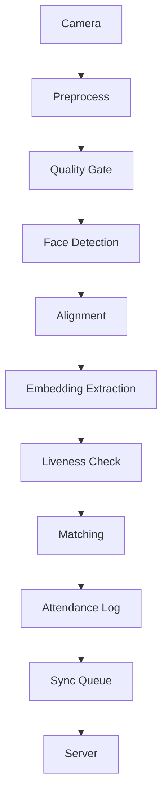

# Face Attendance System

Real-time face recognition attendance for CPU-only edge devices (Raspberry Pi 4, Intel NUC). No GPU required. Target: <1s recognition latency, offline-first, anti-spoofing liveness detection, twin discrimination.

## Project Status

Phases 1–6 of the roadmap are implemented (see `docs/system_design.md` §13.8):

- ✅ **Phase 1 – Core Pipeline**: Camera → Detection → Recognition → Liveness → Database
- ✅ **Phase 2 – Accuracy**: Test-time augmentation, adaptive per-user thresholds, hard-negative mining
- ✅ **Phase 3 – Security**: `KeyStore` (TPM-ready), hash-chained `AuditLog`, mTLS helpers, biohashing
- ✅ **Phase 4 – Offline-First**: LWW-Element-Set CRDT, exponential backoff, zstd delta compression, local autonomy
- ✅ **Phase 5 – Scalability**: vector index (numpy + optional FAISS), hierarchical coarse→fine matching, per-site sharding, management plane
- ✅ **Phase 6 – UX**: local browser UI (webcam), self-service enrollment, attendance dashboard, demo mode without ONNX
- ⚠️ **Missing**: ONNX models, real mTLS socket wiring, FAISS installed (index falls back to numpy)

## Project Overview



### Key Features

- **CPU-first** – Optimized for Raspberry Pi & Intel NUC
- **Offline-first** – Full functionality without internet
- **Anti-spoofing** – Basic liveness detection
- **Biohashing** – Cancelable biometrics for security
- **Modular** – Each component is independently testable

### Current Phase

**Fase 6: UX** (implemented)
- **Local web UI** – browser dashboard (`src/dashboard/`) served by the FastAPI app in `src/api/`; webcam capture + overlay, no Docker
- **Self-service enrollment** – enroll a face from the browser or an uploaded image (`POST /api/enroll`)
- **Live recognition + attendance** – `POST /api/recognize` draws bounding boxes/labels and logs attendance
- **Demo mode** – runs without ONNX models using `SyntheticEmbeddingModel` (`PipelineConfig.demo_mode` / `create_demo_config`)
- **API surface** – `/api/health`, `/api/recognize`, `/api/enroll`, `/api/users`, `/api/attendance`, `/api/stats`, `/api/sync`

<details>
<summary>Fase 5: Scalability (implemented)</summary>

- **Vector index** – `BruteForceIndex` (exact numpy cosine) + optional `FAISSIndex` (HNSW/flat, lazy import) (`src/index/vector_index.py`)
- **Hierarchical matching** – `PCAReducer` (numpy SVD) coarse filter → full-vector refinement (`src/index/hierarchical.py`)
- **Per-site sharding** – `ShardedVectorIndex` routes queries to relevant site shards (`src/index/sharding.py`)
- **Management plane** – `SiteRegistry` provisions sites, model versions, and aggregates health (`src/index/management.py`)
- **Indexed matcher** – `IndexedMatcher` is a drop-in `FaceMatcher` using the ANN index
  (`PipelineConfig.matcher_backend = "indexed"`)

</details>

<details>
<summary>Fase 4: Offline-First (implemented)</summary>

- **CRDT** – `SyncQueue` is backed by an LWW-Element-Set (`src/sync/crdt.py` + `src/sync/queue.py`); enqueue = `add`, ack = tombstone, queues `merge()` conflict-free
- **Exponential backoff** – jittered reconnection policy (`src/sync/backoff.py`)
- **Delta + zstd** – uploads are zstd-compressed deltas signed with Ed25519 (`src/sync/compression.py`, `src/sync/signing.py`)
- **Store-and-forward queue** – bounded queue with backpressure, tombstones, and persistence
- **Local autonomy** – enrollment, template updates, deletions and attendance logging never require the network;
  user/attendance events are queued and synced optionally (`SyncManager` in `src/sync/sync_manager.py`,
  wired via `PipelineConfig.sync_enabled` / `Database.sync_queue`)

</details>

### What Works

```python
# Pipeline initialization
from src.pipeline import create_default_config, FacePipeline

config = create_default_config()
pipeline = FacePipeline(config)
pipeline.start()  # Camera backend
while True:
    frame = pipeline.camera.capture()
    results = pipeline.process_frame(frame)  # Full pipeline
    pipeline.stop()  # Clean shutdown
```

### Test Results

Real pytest suites cover phases 2–6 (`python -X utf8 -m pytest tests/ -v`):
- ✅ Recognition accuracy (phase 2)
- ✅ Security: keystore, audit chain, mTLS helpers (phase 3)
- ✅ Offline-first: CRDT queue, backoff, delta uploads (phase 4)
- ✅ Scalability: vector index, hierarchical, sharding, registry (phase 5)
- ✅ Local web API + synthetic demo model (phase 6)

### Files Structure

```
src/
├── camera/           # Camera capture & hardware abstraction
│   ├── __init__.py
│   └── capture.py
├── detection/        # Face detection with SCRFD
│   ├── __init__.py
│   └── detector.py
├── recognition/      # Embedding extraction with ensemble
│   ├── __init__.py
│   └── extractor.py
├── liveness/         # Anti-spoofing detection
│   ├── __init__.py
│   └── detector.py
├── database/         # Encrypted SQLite storage
│   ├── __init__.py
│   └── database.py
├── security/         # Key storage, audit log, mTLS helpers
│   ├── __init__.py
│   ├── keystore.py
│   ├── audit.py
│   └── tls.py
├── sync/             # Offline-first: CRDT, backoff, compression, queue
│   ├── __init__.py
│   ├── crdt.py
│   ├── backoff.py
│   ├── compression.py
│   ├── queue.py
│   ├── signing.py
│   └── sync_manager.py
├── index/            # Scalability: vector index, hierarchical, sharding
│   ├── __init__.py
│   ├── vector_index.py
│   ├── hierarchical.py
│   ├── sharding.py
│   ├── management.py
│   └── matcher.py
├── pipeline/         # Main integration
│   ├── __init__.py
│   └── pipeline.py
├── api/              # Local web API (FastAPI)
│   ├── __init__.py
│   ├── __main__.py
│   ├── app.py
│   └── schemas.py
└── dashboard/        # Browser UI (HTML/CSS/JS, no build step)
    ├── index.html
    └── static/
        ├── app.js
        └── style.css

tests/
├── camera/           # Camera tests
├── detection/        # Detection tests
├── recognition/      # Recognition tests (+ synthetic model, phase 6)
├── liveness/         # Liveness tests
├── database/         # Database tests
├── security/         # Security (phase 3) tests
├── sync/             # Offline-first (phase 4) tests
├── index/            # Scalability (phase 5) tests
├── api/              # Local web API (phase 6) tests
└── pipeline/         # Integration tests

config/
├── default.yaml      # System configuration
└── local.yaml        # Override settings

models/              # ONNX model files

requirements.txt     # All Python dependencies
main.py              # Entry point
```

### Configuration

Edit `config/local.yaml` to customize:
- Camera device ID, resolution, backend
- Detection model paths and thresholds
- Recognition model ensemble weights
- Database encryption settings
- Sync and logging configuration

```yaml
camera:
  device_id: 0
  width: 640
  height: 480
  backend: "opencv"

detection:
  model: "models/scrfd.onnx"
  conf_threshold: 0.5
  quality:
    min_face_size: 80

recognition:
  models:
    - name: "arcface_r100"
      path: "models/arcface_r100.onnx"
      weight: 0.5
  threshold: 0.45

liveness:
  ear_threshold: 0.25
  head_movement_threshold: 10.0

database:
  path: "data/attendance.db"
  encryption: true
  biohash_token: "device_specific_token"
```

### Running the System

```bash
# Local web UI — no Docker, no ONNX models needed (demo mode)
python -X utf8 main.py --web --demo
#   then open http://127.0.0.1:8000

# Same, via the module
python -X utf8 -m src.api            # demo (synthetic embeddings)
python -X utf8 -m src.api --real     # use real models/…onnx if present

# Test imports
python -X utf8 test_imports.py

# Start the console pipeline (requires actual ONNX models)
python -X utf8 main.py

# Console demo mode (synthetic models; no camera UI windows)
python -X utf8 main.py --demo
```

### Local Web Testing (Phase 6)

The browser dashboard runs the full pipeline on frames captured from your
webcam (or an uploaded image) and needs **no Docker**. In demo mode it runs
without ONNX models using a synthetic embedding model, so you can exercise the
UI, enrollment, and attendance flow end-to-end.

- Start: `python -X utf8 main.py --web --demo`, open `http://127.0.0.1:8000`
- Webcam requires `localhost`/HTTPS (a secure context); `127.0.0.1` is fine.
- Demo mode tests the **flow/UI**, not real face accuracy — real accuracy needs
  `.onnx` models in `models/` (gitignored) and `--real`.
- Tests: `python -X utf8 -m pytest tests/api tests/recognition -v`

### Development Guidelines

1. **Phase 2**: Accuracy enhancements
   - Test-time augmentation
   - Adaptive thresholds
   - Hard-negative mining

2. **Phase 3**: Security hardening
   - Biohashing implementation
   - TPM/secure element key storage
   - Mutual TLS for sync

3. **Phase 4**: Offline-first ✅
   - CRDT (`LWWElementSet`)-backed `SyncQueue` for conflict-free sync
   - Exponential backoff reconnection (with jitter)
   - zstd delta-encoded uploads + Ed25519 signatures
   - Bounded store-and-forward queue with local autonomy (enrollment + attendance)
   - Tests: `python -X utf8 -m pytest tests/sync/ -v`

4. **Phase 5**: Scalability ✅
   - Vector index (`BruteForceIndex` numpy + optional FAISS HNSW)
   - Hierarchical coarse→fine matching (`PCAReducer` + `HierarchicalMatcher`)
   - Sharding per site (`ShardedVectorIndex`)
   - Central management plane (`SiteRegistry`)
   - Tests: `python -X utf8 -m pytest tests/index/ -v`

5. **Phase 6**: UX ✅
   - Real-time overlays (browser canvas)
   - Self-service enrollment (`POST /api/enroll`)
   - Web dashboard (`src/dashboard/`, served by `src/api/`)
   - Demo mode without ONNX models (`SyntheticEmbeddingModel`)
   - Tests: `python -X utf8 -m pytest tests/api tests/recognition -v`

6. **Phase 7**: Production deployment
   - Optional Docker containers
   - System monitoring
   - Automated testing

### Architecture Decisions (Phase 1)

- **CPU-first**: All modules optimized for ARM and Intel CPUs
- **ONNX Runtime**: Hardware-accelerated inference
- **Modular boundaries**: Strict interfaces for testability
- **Biohashing**: Cancelable biometrics
- **Quality gates**: Reject poor frames early
- **Liveness**: Basic motion detection

### Current Limitations

- No actual ONNX models for inference: without them the pipeline runs only in **demo mode**
  (`SyntheticEmbeddingModel`); real accuracy needs `.onnx` models in `models/`
- Simplified liveness detection (bypassed in demo mode)
- Sync is network-agnostic: payloads are signed/compressed but no real mTLS socket is wired yet
- Matching uses Fernet-encrypted embeddings stored at rest; the biohashed template is the
  primary record (biohashes are non-invertible)
- `faiss`/`hnswlib` not installed: vector index falls back to exact numpy `BruteForceIndex`
  (hierarchical matching preserves recall; ANN speedup arrives once FAISS is installed)
- Web UI requires a secure context (localhost/HTTPS) for webcam access; image upload is the fallback
- Basic camera support

### Next Steps

1. Download ONNX models from official sources and validate real accuracy (`--real`)
2. Implement proper liveness detection (MiniFASNet)
3. Add proper matching with FAISS vector search
4. Package for production (systemd/service scripts; optional Docker) and add CI/CD

### Getting Started

1. Install dependencies:
   ```bash
   pip install -r requirements.txt
   ```

2. Download SCRFD and embedding models to `models/`
3. Configure `config/local.yaml` with your device settings
4. Run tests:
   ```bash
   python test_imports.py && python test_pipeline.py
   ```

This completes **Phases 1–6** of the Face Attendance System. The core pipeline runs end-to-end (with dummy data in demo mode), and a local browser UI allows testing without Docker. Phase 7 (production packaging) remains.

## License

This project is licensed under the MIT License - see the [LICENSE](LICENSE) file for details.