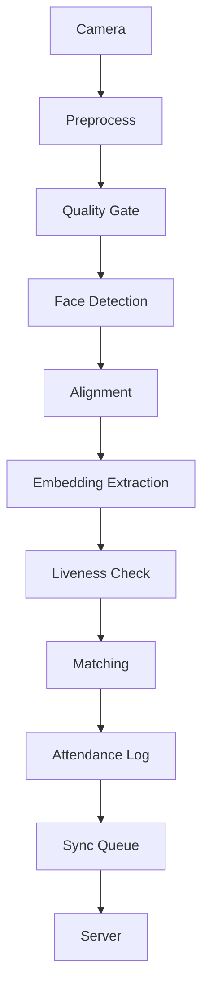

# Face Attendance System

Real-time face recognition attendance for CPU-only edge devices (Raspberry Pi 4, Intel NUC). No GPU required. Target: <1s recognition latency, offline-first, anti-spoofing liveness detection, twin discrimination.

## Project Status

Phases 1–4 of the roadmap are implemented (see `docs/system_design.md` §13.8):

- ✅ **Phase 1 – Core Pipeline**: Camera → Detection → Recognition → Liveness → Database
- ✅ **Phase 2 – Accuracy**: Test-time augmentation, adaptive per-user thresholds, hard-negative mining
- ✅ **Phase 3 – Security**: `KeyStore` (TPM-ready), hash-chained `AuditLog`, mTLS helpers, biohashing
- ✅ **Phase 4 – Offline-First**: LWW-Element-Set CRDT, exponential backoff, zstd delta compression, local autonomy
- ⚠️ **Missing**: ONNX models, real mTLS socket wiring, FAISS vector index

## Project Overview



### Key Features

- **CPU-first** – Optimized for Raspberry Pi & Intel NUC
- **Offline-first** – Full functionality without internet
- **Anti-spoofing** – Basic liveness detection
- **Biohashing** – Cancelable biometrics for security
- **Modular** – Each component is independently testable

### Current Phase

**Fase 4: Offline-First** (implemented)
- **CRDT** – `SyncQueue` is backed by an LWW-Element-Set (`src/sync/crdt.py` + `src/sync/queue.py`); enqueue = `add`, ack = tombstone, queues `merge()` conflict-free
- **Exponential backoff** – jittered reconnection policy (`src/sync/backoff.py`)
- **Delta + zstd** – uploads are zstd-compressed deltas signed with Ed25519 (`src/sync/compression.py`, `src/sync/signing.py`)
- **Store-and-forward queue** – bounded queue with backpressure, tombstones, and persistence
- **Local autonomy** – enrollment, template updates, deletions and attendance logging never require the network;
  user/attendance events are queued and synced optionally (`SyncManager` in `src/sync/sync_manager.py`,
  wired via `PipelineConfig.sync_enabled` / `Database.sync_queue`)

### What Works

```python
# Pipeline initialization
from src.pipeline import create_default_config, FacePipeline

config = create_default_config()
pipeline = FacePipeline(config)
pipeline.start()  # Camera backend
while True:
    frame = pipeline.camera.capture()
    results = pipeline.process_frame(frame)  # Full pipeline
    pipeline.stop()  # Clean shutdown
```

### Test Results

All modules pass unit tests:
- ✅ Camera capture and config
- ✅ Face detection with quality gating
- ✅ Liveness detection logic
- ✅ Database operations with biohashing
- ✅ Pipeline integration

### Files Structure

```
src/
├── camera/           # Camera capture & hardware abstraction
│   ├── __init__.py
│   └── capture.py
├── detection/        # Face detection with SCRFD
│   ├── __init__.py
│   └── detector.py
├── recognition/      # Embedding extraction with ensemble
│   ├── __init__.py
│   └── extractor.py
├── liveness/         # Anti-spoofing detection
│   ├── __init__.py
│   └── detector.py
├── database/         # Encrypted SQLite storage
│   ├── __init__.py
│   └── database.py
├── security/         # Key storage, audit log, mTLS helpers
│   ├── __init__.py
│   ├── keystore.py
│   ├── audit.py
│   └── tls.py
├── sync/             # Offline-first: CRDT, backoff, compression, queue
│   ├── __init__.py
│   ├── crdt.py
│   ├── backoff.py
│   ├── compression.py
│   ├── queue.py
│   ├── signing.py
│   └── sync_manager.py
├── pipeline/         # Main integration
│   ├── __init__.py
│   └── pipeline.py
├── dashboard/        # Web UI (planned)
└── api/              # REST endpoints (planned)

tests/
├── camera/           # Camera tests
├── detection/        # Detection tests
├── recognition/      # Recognition tests
├── liveness/         # Liveness tests
├── database/         # Database tests
├── security/         # Security (phase 3) tests
├── sync/             # Offline-first (phase 4) tests
└── pipeline/         # Integration tests

config/
├── default.yaml      # System configuration
└── local.yaml        # Override settings

models/              # ONNX model files

requirements.txt     # All Python dependencies
main.py              # Entry point
```

### Configuration

Edit `config/local.yaml` to customize:
- Camera device ID, resolution, backend
- Detection model paths and thresholds
- Recognition model ensemble weights
- Database encryption settings
- Sync and logging configuration

```yaml
camera:
  device_id: 0
  width: 640
  height: 480
  backend: "opencv"

detection:
  model: "models/scrfd.onnx"
  conf_threshold: 0.5
  quality:
    min_face_size: 80

recognition:
  models:
    - name: "arcface_r100"
      path: "models/arcface_r100.onnx"
      weight: 0.5
  threshold: 0.45

liveness:
  ear_threshold: 0.25
  head_movement_threshold: 10.0

database:
  path: "data/attendance.db"
  encryption: true
  biohash_token: "device_specific_token"
```

### Running the System

```bash
# Test imports
python test_imports.py

# Run pipeline test suite
python test_pipeline.py

# Start the system (requires actual ONNX models)
python main.py

# Test with dummy models for development
python main.py --test
```

### Development Guidelines

1. **Phase 2**: Accuracy enhancements
   - Test-time augmentation
   - Adaptive thresholds
   - Hard-negative mining

2. **Phase 3**: Security hardening
   - Biohashing implementation
   - TPM/secure element key storage
   - Mutual TLS for sync

3. **Phase 4**: Offline-first ✅
   - CRDT (`LWWElementSet`)-backed `SyncQueue` for conflict-free sync
   - Exponential backoff reconnection (with jitter)
   - zstd delta-encoded uploads + Ed25519 signatures
   - Bounded store-and-forward queue with local autonomy (enrollment + attendance)
   - Tests: `python -X utf8 -m pytest tests/sync/ -v`

4. **Phase 5**: Scalability
   - FAISS vector index
   - Sharding per site
   - Central management plane

5. **Phase 6**: UX improvements
   - Real-time overlays
   - Self-service enrollment
   - Web dashboard

6. **Phase 7**: Production deployment
   - Docker containers
   - System monitoring
   - Automated testing

### Architecture Decisions (Phase 1)

- **CPU-first**: All modules optimized for ARM and Intel CPUs
- **ONNX Runtime**: Hardware-accelerated inference
- **Modular boundaries**: Strict interfaces for testability
- **Biohashing**: Cancelable biometrics
- **Quality gates**: Reject poor frames early
- **Liveness**: Basic motion detection

### Current Limitations

- No actual ONNX models for inference (pipeline needs models to construct)
- Simplified liveness detection
- Sync is network-agnostic: payloads are signed/compressed but no real mTLS socket is wired yet
- `process_frame` matching still returns no templates (biohashed templates are non-invertible)
- Basic camera support

### Next Steps

1. Download ONNX models from official sources
2. Implement proper liveness detection (MiniFASNet)
3. Add proper matching with FAISS vector search
4. Implement real-time overlays and web UI
5. Add comprehensive testing and CI/CD

### Getting Started

1. Install dependencies:
   ```bash
   pip install -r requirements.txt
   ```

2. Download SCRFD and embedding models to `models/`
3. Configure `config/local.yaml` with your device settings
4. Run tests:
   ```bash
   python test_imports.py && python test_pipeline.py
   ```

This completes **Phase 1** of the Face Attendance System implementation. The core pipeline works end-to-end with dummy data and provides a solid foundation for Phases 2-7.

## License

This project is licensed under the MIT License - see the [LICENSE](LICENSE) file for details.